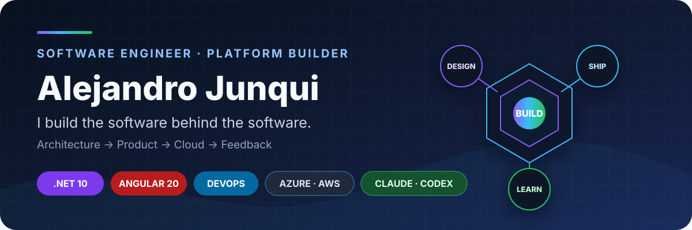

  

  
  
  

> **De una idea a producción, sin perder la arquitectura por el camino.**
>
> Tengo más de 9 años construyendo y modernizando software empresarial. Hoy mi foco está en crear plataformas que reduzcan la fricción entre producto, desarrollo y operaciones.

## Ahora

~~~yaml
building: "Hexagon — una plataforma reutilizable para crear productos"
backend:  ".NET 10 · modular monolith · Aspire · PostgreSQL · Keycloak"
frontend: "Angular 20 · TypeScript · Tailwind CSS"
delivery: "Terraform · Docker · CI/CD · OCI"
cloud:    "Azure · AWS"
events:   "Azure Service Bus · AWS SNS/SQS · RabbitMQ · outbox/inbox"
ai_pair:  "Claude · Codex"
~~~

## El problema que estoy resolviendo

Un equipo de producto no debería volver a inventar autenticación, multi-tenancy, mensajería, observabilidad, pipelines y despliegues cada vez que inicia un repositorio.

Estoy construyendo un **paved road** técnico: una base con decisiones, contratos y guardrails que permite concentrarse en el dominio sin convertir la plataforma en una caja negra.

### 01 — Build

Backend modular con **.NET 10**, Clean Architecture, DDD y CQRS; frontend con **Angular 20** y configuración promovible entre ambientes. La arquitectura se comprueba con código y pruebas, no solo con diagramas.

### 02 — Ship

**DevOps forma parte del diseño.** CI/CD, Terraform, Docker, quality gates y artefactos OCI conectan cada commit con una entrega repetible. Aplicación e infraestructura se comunican mediante contratos versionados.

### 03 — Run

La plataforma está pensada para operar en **Azure y AWS**: identidad, telemetría, salud, mensajería y recuperación ante fallos. Azure Service Bus, AWS SNS/SQS y RabbitMQ comparten semántica de aplicación sin esconder las diferencias del proveedor.

## Del commit a producción

~~~mermaid
flowchart LR
    A["Problema"] --> B["Decisiones"]
    B --> C[".NET + Angular"]
    C --> D["Tests + Quality Gates"]
    D --> E["OCI + Terraform"]
    E --> F["Azure / AWS"]
    F --> G["Telemetry"]
    G -. feedback .-> B
~~~

Mi trabajo vive en todo el circuito: arquitectura, implementación, revisión, automatización, despliegue, observabilidad e incidentes.

## IA en mi workflow

Uso IA como multiplicador de ingeniería, no como sustituto del criterio.

- **Claude — explorar y cuestionar:** alternativas de arquitectura, trade-offs, análisis profundo y claridad documental.
- **Codex — implementar y comprobar:** cambios conscientes del repositorio, refactors, pruebas, automatización y revisiones.
- **Yo — decidir y responder:** intención, restricciones, seguridad, validación y responsabilidad final sobre lo que llega a producción.

> La IA acelera el ciclo. Las pruebas aportan evidencia. El criterio humano conserva la responsabilidad.

## Prueba > promesa

- [**Hexagon .NET Suite**](https://github.com/ajunquit/hexagon-dotnet-suite) + [**Angular Template**](https://github.com/ajunquit/hexagon-free-ng)  
  La base pública de mi trabajo de plataforma: .NET, Angular, arquitectura limpia y automatización.

- [**.NET Backend Blueprint**](https://github.com/ajunquit/dotnet-backend-template)  
  .NET 10, Aspire, PostgreSQL, Keycloak, Azure Service Bus, workers, health checks, integración y CI/CD.

- [**Payment Initiation API**](https://github.com/ajunquit/hiberus)  
  Java 17, Spring Boot 3, OpenAPI contract-first, arquitectura hexagonal y quality gates verificables.

## Mis invariantes

- **La arquitectura debe ser ejecutable:** dependencias, contratos y límites se validan automáticamente.
- **La operación empieza en el diseño:** salud, telemetría, idempotencia y recuperación no son tareas posteriores.
- **La documentación es parte del producto:** decisiones y caminos de adopción deben sobrevivir a quien los escribió.
- **La plataforma debe reducir carga cognitiva:** buenos defaults, escape hatches explícitos y cero magia innecesaria.
- **Sigo siendo hands-on:** diseño, código, reviews, pruebas y acompañamiento a producción.

---

  <strong>¿Construimos algo que pueda evolucionar?</strong> 
  <a href="https://www.linkedin.com/in/ajunquit">LinkedIn</a> ·
  <a href="mailto:ajunquit@gmail.com">ajunquit@gmail.com</a>

